<p align="center">
  
</p>

<h1 align="center">/architect</h1>

<p align="center">
  <b>Your Anaplan build buddy.</b><br>
  Ask your models why, what breaks, and how to build it. Every answer is cited and checked.
</p>

<p align="center">
  <a href="https://codelessops.com/anaplan-architect/"><b>Website</b></a> ·
  <a href="docs/WALKTHROUGH.md"><b>Walkthrough</b></a> ·
  <a href="docs/features/README.md"><b>Features</b></a> ·
  <a href="docs/SECURITY.md"><b>Security</b></a> ·
  <a href="#run-it-yourself"><b>Run it</b></a>
</p>

<p align="center">
  
  
  
  
</p>

<p align="center">
  
</p>

Upload the line item, module and action exports of your models and your project documents, then ask. Every answer
cites the objects and passages it rests on, is checked before you see it, and says **Not recorded** when nobody
wrote the reason down.

Free, MIT licensed, by [CodelessOps](https://codelessops.com). Yours to run, on your own machine, with your own
model key.

## Six questions it answers

<table>
<tr>
<td width="50%" valign="top">
<h3>Why was it built this way?</h3>
<blockquote>Why is the account mapping written into the Forecast Opex formula instead of a lookup table?</blockquote>
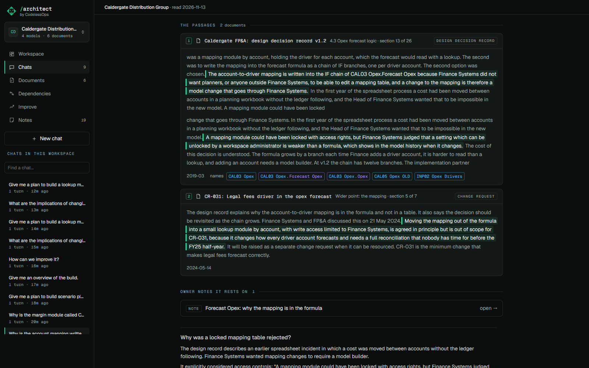
<p>The reason in a few lines, and under it the passage that records it, word for word, with the document, the
section and the date.</p>
</td>
<td width="50%" valign="top">
<h3>How would I build that?</h3>
<blockquote>Give me a plan to build a lookup module that replaces the account mapping inside Forecast Opex.</blockquote>
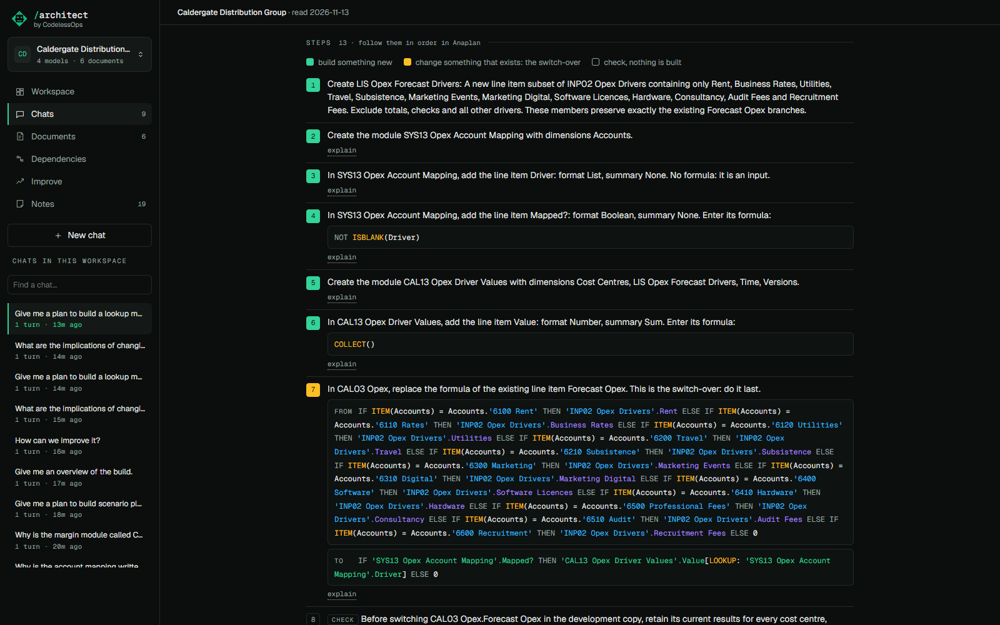
<p>Steps you can follow in Anaplan: modules and line items with formats, dimensions and formulas, ending with the
formula that switches over and what to check.</p>
</td>
</tr>
<tr>
<td width="50%" valign="top">
<h3>What happens if I change this?</h3>
<blockquote>What are the implications of changing SYS05 FX Rates?</blockquote>
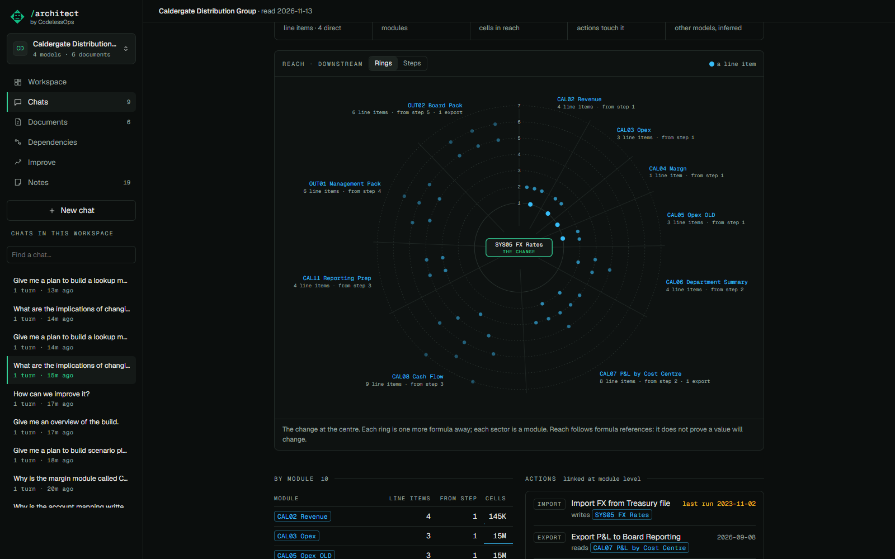
<p>The reach of the change: line items, modules and cells that read it, drawn as rings by distance, with the
actions and the other models it touches.</p>
</td>
<td width="50%" valign="top">
<h3>What have I got here?</h3>
<blockquote>Give me an overview of the build.</blockquote>
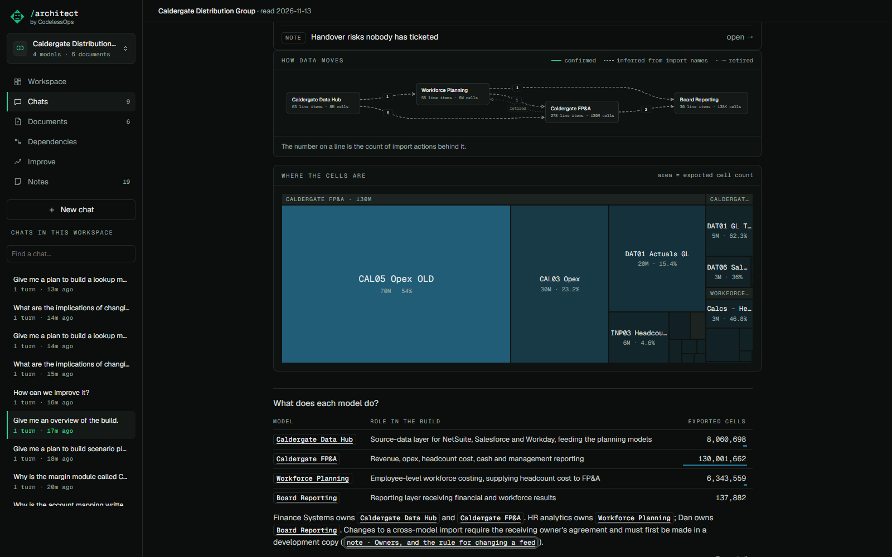
<p>Which model feeds which, where the cells are, what each model is for. Useful on day one of an inherited
estate.</p>
</td>
</tr>
<tr>
<td width="50%" valign="top">
<h3>What should we fix first?</h3>
<blockquote>How can we improve it?</blockquote>
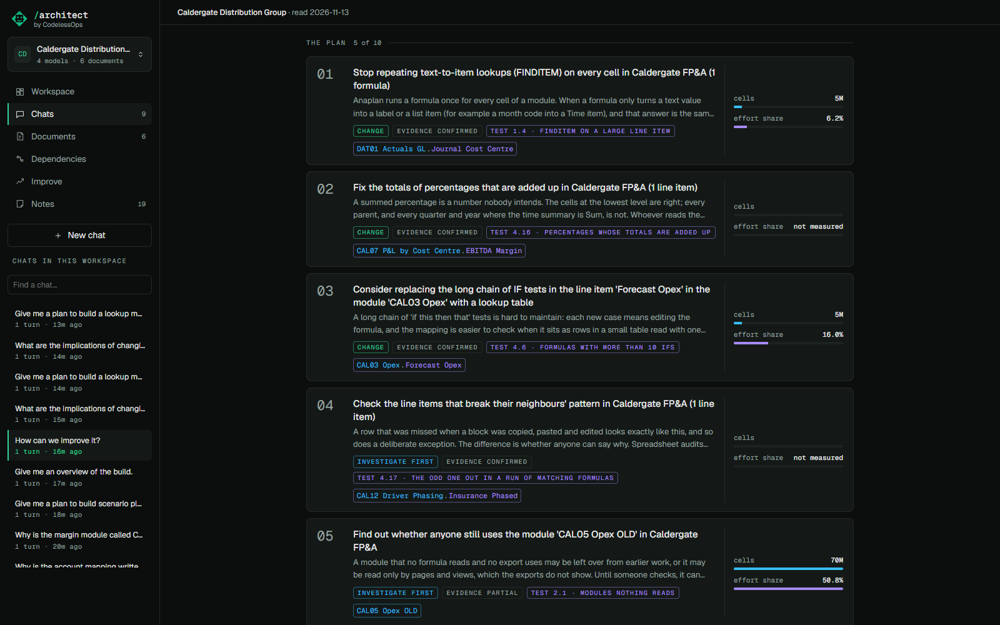
<p>Ranked cards, each with the test behind it, the cells it concerns and its share of calculation effort.</p>
</td>
<td width="50%" valign="top">
<h3>How many, and which?</h3>
<blockquote>How many line items use FINDITEM, and which modules are they in?</blockquote>
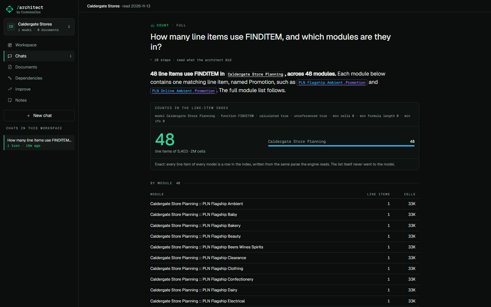
<p>An exact count, however large the model. The demo includes one model of 5,403 line items to try it on.</p>
</td>
</tr>
</table>

Every answer comes in two modes. **Full** gives the diagram, the sources and the tables. **Concise** gives only what
you act on, with *show diagram*, *explain* and *expand to Full* one click away.

## A language model writes it. Code checks it.

<table>
<tr>
<td width="50%" valign="top">
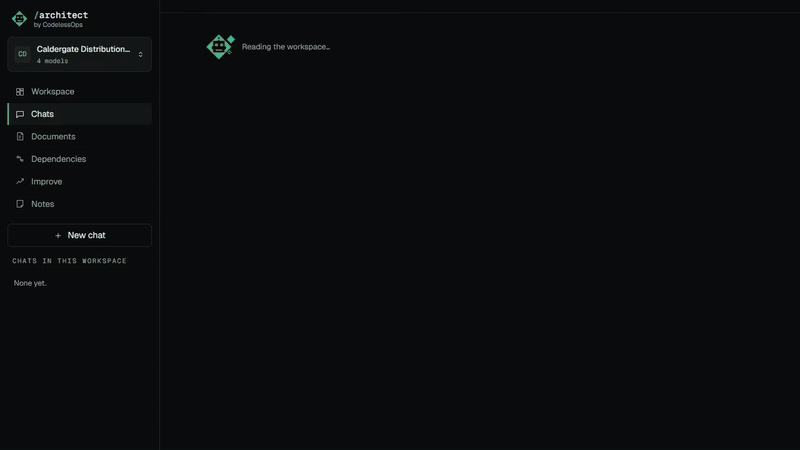
</td>
<td width="50%" valign="top">

| | Checked before you see it |
|---|---|
| **Names** | Every module and line item is looked up in your exports. One your model does not have is listed as not found. |
| **Figures** | Each must come from what the tools returned for that question. |
| **Quotes** | Each must be in the section it cites, word for word. |
| **Why** | Must rest on a passage or a note. With neither: *Not recorded*. |
| **Plans** | Not shown unless every formula parses, every name exists or is built by the plan, nothing is built before what it refers to, and no change closes a circular reference. |

</td>
</tr>
</table>

And you can look for yourself. Click any name to open its formula, its dimensions and the export row it came from.
Under each answer, the **context** chip lists exactly what the model was given, and the **run timeline** shows each
step it took.

<table>
<tr>
<td width="50%">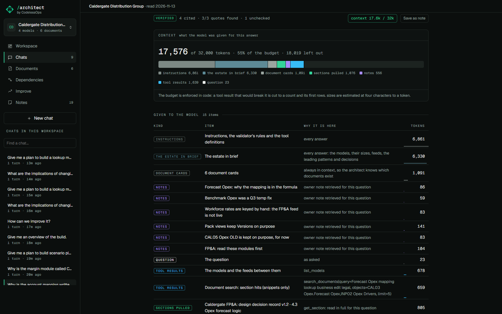</td>
<td width="50%">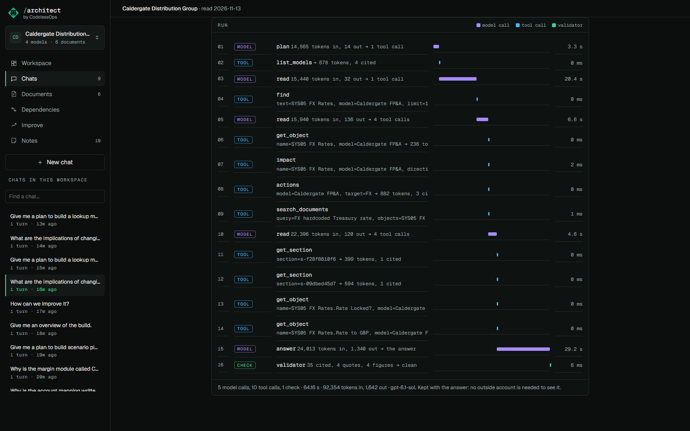</td>
</tr>
<tr>
<td align="center"><sub><a href="docs/features/context.md">The context view</a></sub></td>
<td align="center"><sub><a href="docs/features/run-timeline.md">The run timeline</a></sub></td>
</tr>
</table>

More: [the validator](docs/features/validator.md), [build plans](docs/features/build-plans.md).

## See it move

<table>
<tr>
<td width="50%"></td>
<td width="50%">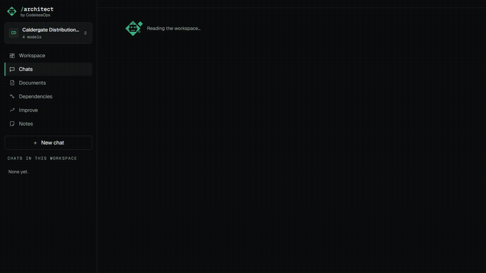</td>
</tr>
<tr>
<td align="center"><sub>Walk the reach of a change</sub></td>
<td align="center"><sub>Concise answer, diagram on request</sub></td>
</tr>
</table>

## Also in the box

<table>
<tr>
<td width="33%">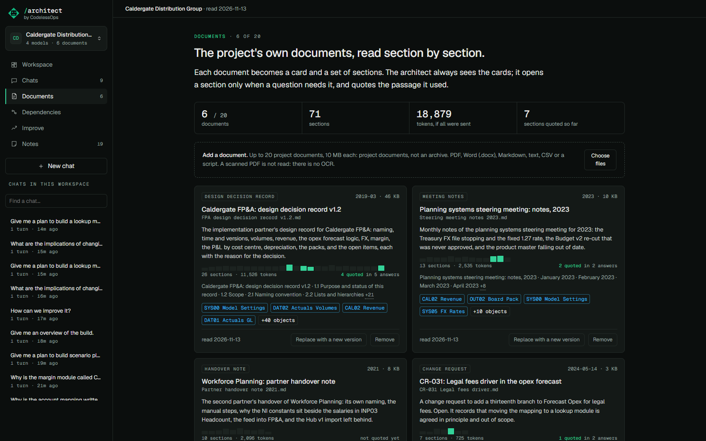</td>
<td width="33%">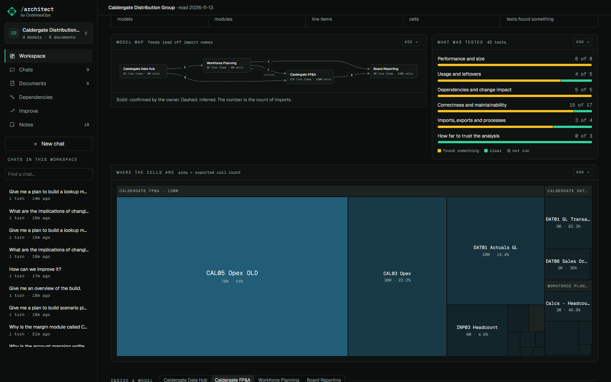</td>
<td width="33%">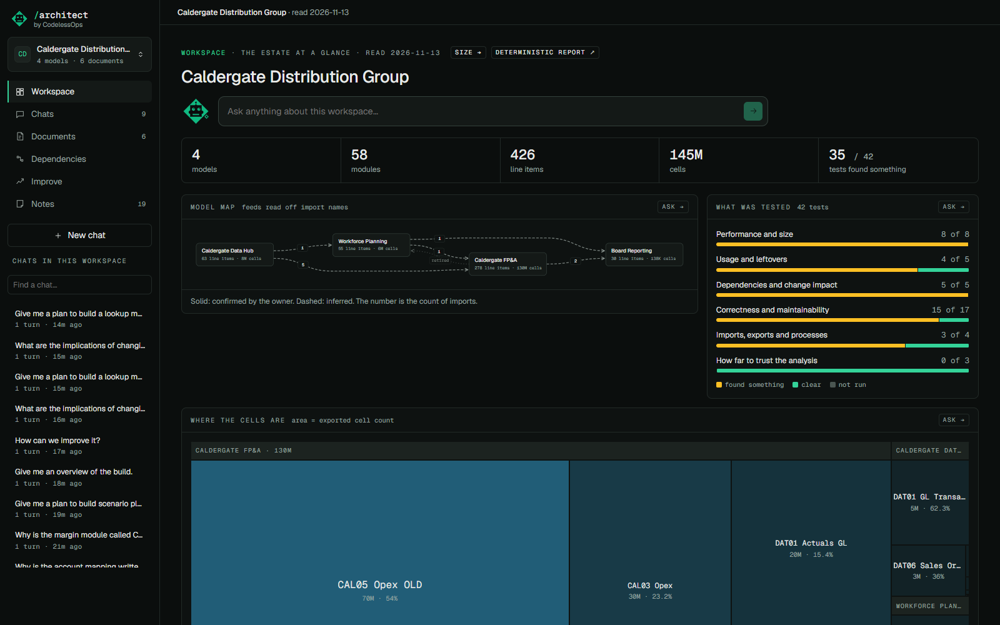</td>
</tr>
<tr>
<td align="center"><sub><a href="docs/features/documents.md">Your documents, searchable by section</a></sub></td>
<td align="center"><sub>The model map</sub></td>
<td align="center"><sub>The workspace at a glance</sub></td>
</tr>
<tr>
<td width="33%">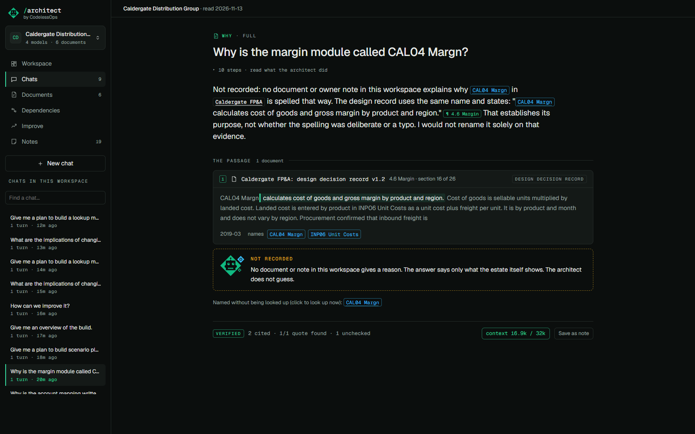</td>
<td width="33%">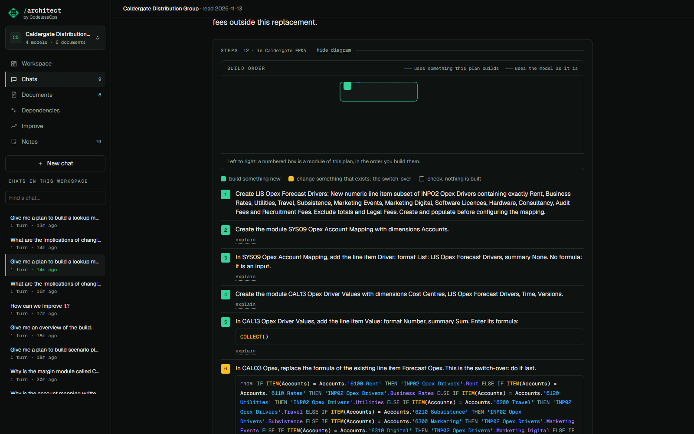</td>
<td width="33%">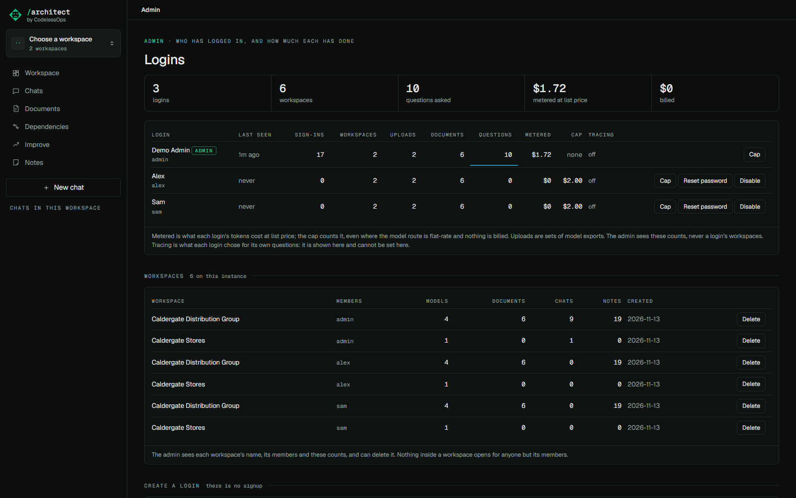</td>
</tr>
<tr>
<td align="center"><sub>It says so when nobody wrote it down</sub></td>
<td align="center"><sub><a href="docs/features/concise-and-full.md">Concise and Full</a></sub></td>
<td align="center"><sub><a href="docs/features/spend-caps-and-admin.md">Logins and spend caps</a></sub></td>
</tr>
</table>

## Run it yourself

Clone it and run it. You need Python 3.10 or later and git.

```bash
git clone https://github.com/klameer/anaplan-architect.git
cd anaplan-architect
python -m venv .venv
.venv/bin/pip install ".[llm,web,openai]"        # Windows: .venv\Scripts\pip. Needs git: see the note below
.venv/bin/anaplan-architect demo --data ./data   # optional: the demo workspaces
.venv/bin/anaplan-architect serve --data ./data
```

Then open `http://localhost:8765`. The demo workspaces open without a model key; to ask questions, put your key
in `.env` first (copy `.env.example`).

<details>
<summary><b>With Docker instead</b></summary>

```bash
docker compose up
```

Builds the image on your machine and opens at `http://localhost:8765`. No login: the port is published to your
machine only. Two fictional demo workspaces are there on first start. The image is written and has not yet been
built and run by its author; the route above is the one that has been followed from a clean clone.

</details>

<details>
<summary><b>On a server for your team</b></summary>

The same image with a volume, an admin, and `ARCHITECT_HOSTED=1`. The admin creates each login; there is no signup.
See [Hosting](docs/features/hosting.md).

</details>

You need a model: an Anthropic key, Claude on Bedrock, Azure OpenAI, or any OpenAI-compatible endpoint, including
one inside your organisation. See [Model providers](docs/features/model-providers.md). Your exports and documents
stay on the machine that runs it; what goes to the model for each answer is listed under that answer.

### Try it on the demo first


Settings, *Reset the demo* (or `anaplan-architect demo --data ./data`) writes two fictional workspaces:

- **Caldergate Distribution Group**: four models, six project documents, nineteen owner notes.
- **Caldergate Stores**: one model of 5,403 line items.

Everything in them is invented. [The walkthrough](docs/WALKTHROUGH.md) clicks through every feature on them and
says what you should see.

### Or ask for a login

Karim runs a hosted test instance. A login is by request and at his discretion: not everyone who asks gets one.

> [!IMPORTANT]
> If you get one:
>
> - it is a test instance. Access can be withdrawn at any time, and the instance may be reset;
> - do not upload anything you are not allowed to share. Your employer's model exports are your employer's;
> - in the app he sees how much each login uses (sign-ins, counts, spend) and each workspace's name, not what is in
>   it. But he runs the server, and the server holds your files unencrypted: treat anything you upload as readable
>   by him. Your questions are not sent to any tracing service unless you turn that on yourself;
> - each login has a spend cap.

To ask, send Karim a message on [LinkedIn](https://linkedin.com/in/karimlameer). That is the only route: not through the
website and not by email. If you would rather not wait or not share: run it yourself. That is what it is for.

## How it works underneath

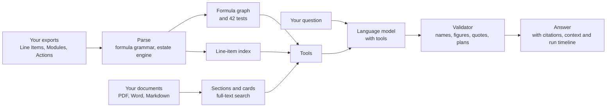

One process, one SQLite file, no vector store and no indexing service. The model never sees your whole estate: it is
given a summary and tools, and pulls only what a question needs.

| | |
|---|---|
| [Workspaces and logins](docs/features/workspaces-and-logins.md) | [Documents](docs/features/documents.md) |
| [The line-item index](docs/features/line-item-index.md) | [The five answer patterns](docs/features/answer-patterns.md) |
| [Build plans](docs/features/build-plans.md) | [Concise and Full](docs/features/concise-and-full.md) |
| [The context budget and context view](docs/features/context.md) | [The run timeline](docs/features/run-timeline.md) |
| [The validator](docs/features/validator.md) | [Tracing](docs/features/tracing.md) |
| [Spend caps and the admin panel](docs/features/spend-caps-and-admin.md) | [Backup and restore](docs/features/backup-and-restore.md) |
| [Model providers](docs/features/model-providers.md) | [Hosting](docs/features/hosting.md) |

Also: [what it protects and what it does not](docs/SECURITY.md).

## For developers

The Python install fetches the two libraries this is built on from GitHub, so `git` must be on the path:
[anaplan-grammar](https://github.com/klameer/anaplan-grammar) at v0.1.0 (the formula parser) and
[anaplan-estate](https://github.com/klameer/anaplan-estate) at v0.2.0 (the deterministic estate report), pinned to a commit each in `pyproject.toml` and `pins.json`.
Neither is on PyPI. Each is pinned to the commit its tag names (`8a5683b50a79` and `559f4fdde000`), the same in
`pyproject.toml`, `pins.json` and the `Dockerfile`. `constraints.txt` holds the versions of everything else; the
image installs with it, and so can you: `pip install -c constraints.txt ".[llm,web,openai]"`.

```bash
pip install -e ".[llm,web,openai,trace]" pytest httpx                  # with the two pinned libraries, at their pinned commits
pytest                                                                 # the Python tests
cd web && npm install && npm test && npm run build                     # the React app, built into the package
```

On Railway, a volume cannot be declared in `railway.json`: attach one to the service. The image keeps the store
wherever Railway mounts it (`RAILWAY_VOLUME_MOUNT_PATH`).

The page says **workspace**; the code and the store say **estate** (table `estates`, routes `/api/estates/...`). They
are the same thing. The store's own `workspaces` table is the instance itself.

## Licence, citation, branding

MIT: see `LICENSE`. If this helps your work, a citation is appreciated but not required: see `CITATION.cff`.

It ships with CodelessOps branding: the name, the logo and Bert, the mascot. You may replace them in a copy you run.

Not affiliated with or endorsed by Anaplan. Anaplan is a trademark of its owner.
