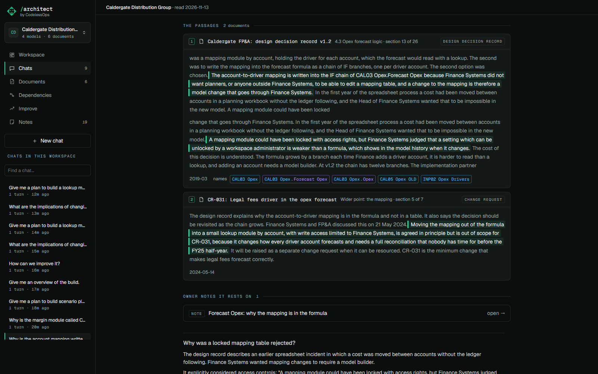
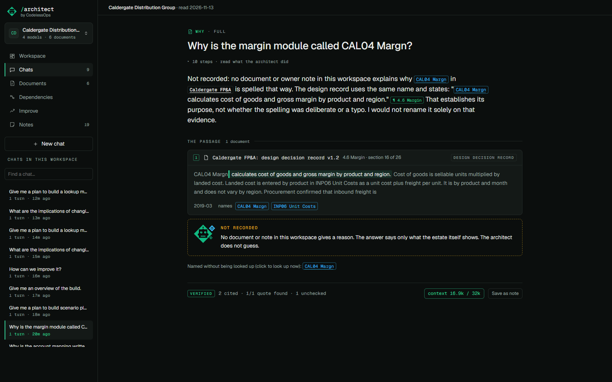
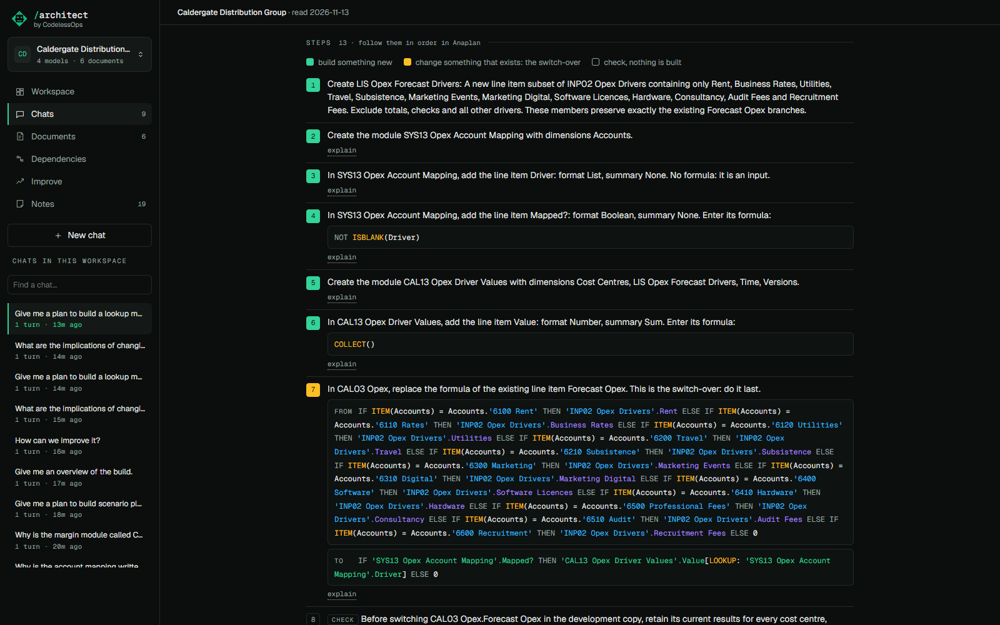
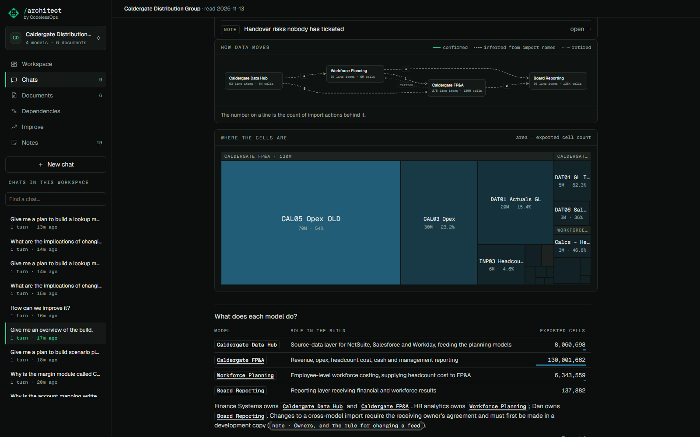
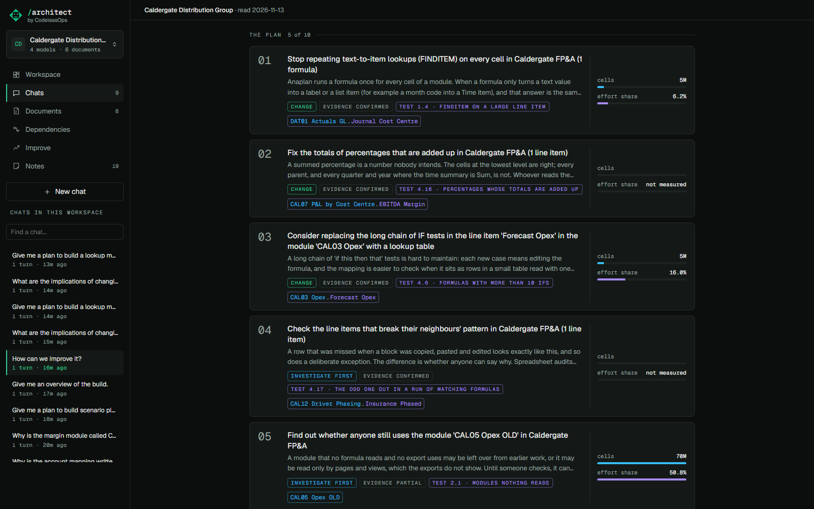
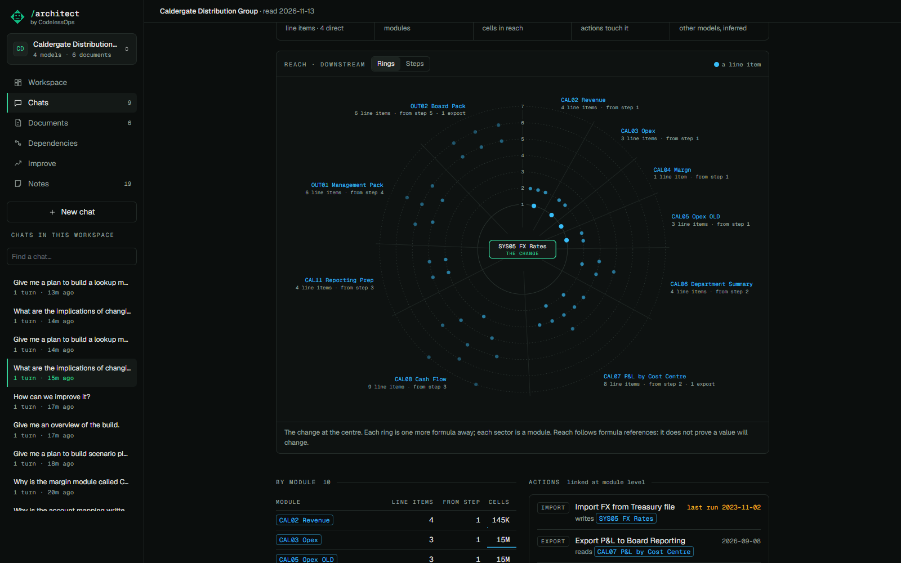

# The five answer patterns

Each kind of question has its own shape of answer: a few lines first, then the figure or evidence that kind of
question needs. A sixth, the exact count, is on [its own page](line-item-index.md).

## Why was it built this way

Ask: *Why is the account mapping written into the Forecast Opex formula instead of a lookup table?*

You get the reason in a few lines, and under it the passage that records it, quoted word for word on a source card
with the document, the section and the date. If no document and no owner note gives a reason, the answer says
**Not recorded** and then only what the estate itself shows. It does not guess.

## Give me a plan to build something

Ask: *Give me a plan to build a lookup module that replaces the account mapping inside Forecast Opex.*

You get instructions: what you will build, what already exists that it uses, and numbered steps to follow in
Anaplan, ending with the existing formula that switches over and what to check afterwards.
[Build plans](build-plans.md) has the detail.

## Give me an overview

Ask: *Give me an overview of the build.*

You get the model map (which model feeds which, read off the import actions) and where the cells are, then prose.

## How can we improve it

Ask: *How can we improve it?*

You get ranked cards, each with the test behind it, the cells it concerns and its share of calculation effort. The
cards are the deterministic result of 42 tests over the estate, not the model's opinion; the model explains them.

## What are the implications of changing this

Ask: *What are the implications of changing SYS05 FX Rates?*

You get the reach: how many line items, in how many modules, holding how many cells, read the thing you would
change, drawn as rings by distance, or as steps. Then by module, the actions that touch it, other models it reaches,
and what the exports cannot show.

## How it is built

- The kind is decided from what was asked and which tools the answer used: `question_kind` in
  `src/anaplan_architect/chat.py`.
- The figures are drawn from data the tools returned, kept on the answer as *blocks* (`_blocks` in `chat.py`), so the
  page can draw them again without asking the model. The components are in `web/src/views/Answer.tsx`,
  `web/src/views/PlanBlock.tsx` and `web/src/design/diagrams.tsx`.
- Reach is counted over the formula graph, each line item once at its shortest distance (`orac/deps.py`).
- The improvement plan is `orac/plan.py` over the tests of the estate engine.
