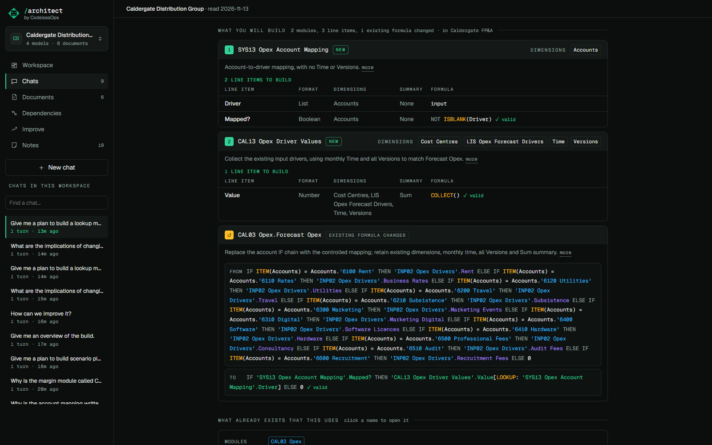
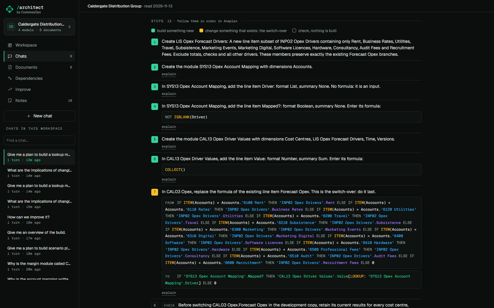

# Build plans

## What it does

Ask for a plan to build something and you get instructions a builder can follow in Anaplan, not an essay.

In reading order:

1. **Overview**: what will be built and why, and what it replaces. Three or four plain sentences.
2. **What you will build**: each module, numbered in build order, with its dimensions, its purpose and, under it, its
   line items: name, format, dimensions, summary and the formula in full. Then each existing formula that changes,
   shown from and to.
3. **What already exists that this uses**: the existing modules, line items and lists the build refers to. Click a
   name to open it.
4. **Steps**: numbered. Create the list. Create the module with these dimensions. Add this line item with this
   format and this formula. Last of the build, replace the existing formula: the switch-over. Then what to check.
5. If a document records why this was wanted, the passage, after the plan.

The colour of a step's number: green builds something new; amber changes something that exists; outlined is a check.

Take it with you as Markdown, or as CSV with one row per line item.

## What is checked before you see a plan

The model proposes. Code checks, and a plan that fails is not shown:

- **Every formula parses** with a grammar of Anaplan's formula language.
- **Every name exists**: each reference is resolved against the model as it is and against what the plan itself
  builds. A reference to a line item that is not there rejects the plan.
- **Nothing is built before what it refers to.** Line items are put in an order that works. Two new modules may
  read each other, as Anaplan allows, as long as no line item waits on itself; the steps then go line item by line item.
- **A change cannot close a loop.** The changed formula is followed through the plan's own line items and the
  model's existing formulas; if it comes back to itself, the plan is refused as a circular reference.
- **Formats are Anaplan's.** `Number`, `Boolean`, `Text`, `Date`, `List`, `Time period`, `No data`.
- **Names in notes and checks exist.** A name put in backticks must be an object of the model or of the plan.

The page says it in one line under the steps: *order checked: nothing is built before what it refers to*.

## What it does not do

A plan is a proposal. Nothing is built in Anaplan. The exports hold no list members and no line item subsets, so a
step that creates one is taken from the model's words, not checked. The formulas need an Anaplan builder's read.

## How it is built

- The chat tool `build_plan` takes the modules and line items, the existing line items to change, the lists it
  needs, and what to check afterwards. Read `src/anaplan_architect/orac/buildplan.py`: `check` validates, `steps`
  writes the numbered instructions from the checked plan, `to_markdown` and `to_csv` export it.
- The formula grammar is [anaplan-grammar](https://github.com/klameer/anaplan-grammar).
- The page is `web/src/views/PlanBlock.tsx`.
- Tests: `tests/test_buildplan.py`.
