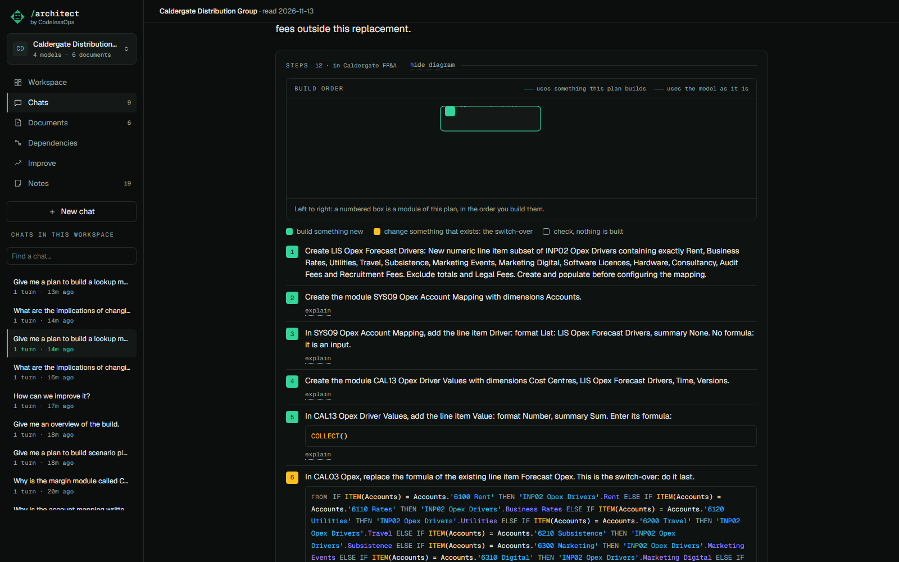

# Concise and Full

## What it does

Two ways to get the same answer.

- **Full**: the answer in a few lines, then the diagram, the source cards and the tables for its kind of question.
- **Concise**: only what you act on. For a plan, the numbered steps and what exists. For a reach, the key figures.
  For a count, the count.

Nothing is lost in Concise. It is one click away:

- **show diagram** opens the figure in place;
- **explain** on a step opens that step's note in place;
- **expand to Full** draws the full answer, without asking again.

## How to use it

The **Concise / Full** switch is on the composer, for the question you are about to ask. Your default is in
Settings, *Answer mode*. A new login starts on Full.

## How it is built

- The mode is passed with the question and adds an instruction to the prompt for Concise (`CONCISE` in
  `src/anaplan_architect/chat.py`). It is stored on the answer.
- The figures of an answer are drawn from data the tools returned, kept on the answer as blocks. That is why
  *expand to Full* and *show diagram* need no second question: the page already has what it needs. See `Blocks` in
  `web/src/views/Answer.tsx`.
- The default is a per-login preference (`GET` and `PUT /api/prefs`).
