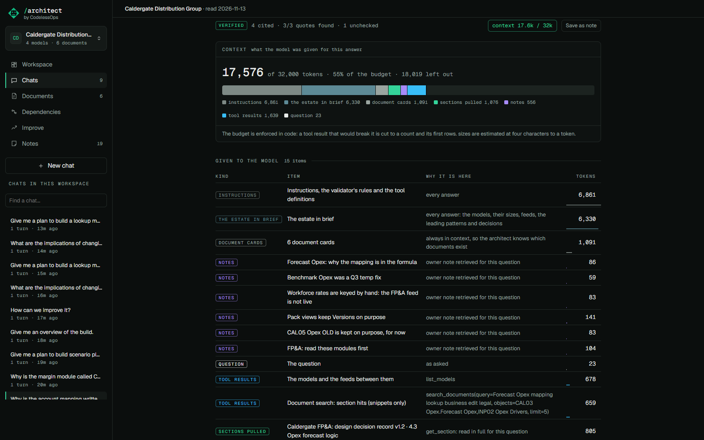

# The context budget and the context view

## What it does

Under every answer is a chip such as **context 16.5k / 32k**. It opens the list of everything the model was given
to write that answer, each item with why it is there and its size, and the list of what was left out.

The point: a good answer comes from a small, relevant context, not from pouring everything in. You can see that it
was small, and you can see exactly what left your machine for that question.

## How to use it

Click the chip under an answer.

- **Given to the model**: the instructions, the estate in brief, the document cards, the owner notes retrieved for
  the question, each tool result, each document section pulled.
- **Left out**: for example the other 25 sections of a design record from which one section was read.
- A bar shows the split by kind against the budget.

Sizes are estimates at four characters to a token, and the panel says so.

## How it is built

- The budget is 32,000 tokens for one answer (`ARCHITECT_CONTEXT_BUDGET`). A tool result that would take the answer
  over it is cut, and the cut is listed as left out.
- Each item is recorded as it is sent, in `Session.ask_stream` in `src/anaplan_architect/chat.py`, and stored on the
  answer (`context_json`). The panel is `ContextPanel` in `web/src/views/Answer.tsx`.
- Documents enter as cards only. A section enters only when the answer reads it
  ([Documents](documents.md)). Line items enter as a count and a few rows ([the index](line-item-index.md)).
- The instructions and the estate summary take about 12,000 tokens before any question; they are cached by the
  provider where it supports that.
