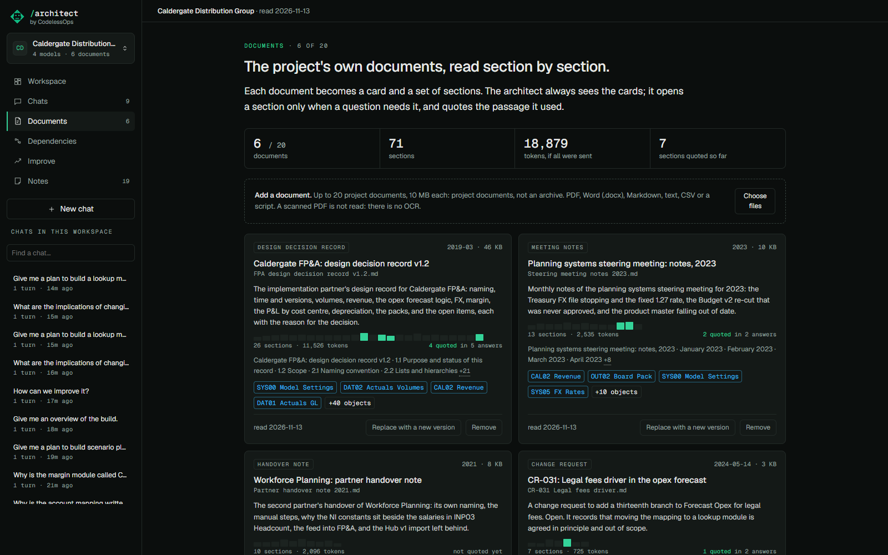

# Documents

## What it does

The exports say what a model is. They do not say why it was built that way. That lives in project documents: a
design decision record, steering notes, a handover note, a change request, a load script. Upload them and a question
that starts with "why" is answered from the passage that records the reason, quoted word for word.

## How to use it

- **Documents** in the nav. *Choose files*: PDF, Word (.docx), Markdown, text, CSV, or a script.
- Each document becomes a **card**: type, date, a two-sentence summary, a strip with one bar per section, its
  headings, and the models, modules and line items it names.
- **Replace with a new version** keeps the card and marks the version. **Remove** takes it away.
- Limits: 20 documents per workspace, 10 MB each. A scanned PDF has no text to read: there is no OCR, and the card
  says so.
- In an answer, a quoted passage shows as a **source card** with the quote marked and the text around it. Click its
  head to open the whole section.

## How it is built

No embeddings and no vector store. Read `src/anaplan_architect/orac/documents.py`.

- **Sections.** A document is split at its headings (Markdown, numbered headings like "4.3 Opex forecast logic",
  Word heading styles, a script's functions). A long section is cut at paragraph ends. YAML front matter is skipped
  and its title used.
- **Cards.** The model sees only the cards: title, type, date, headings, summary, the objects named. A card is not
  evidence. The summary is written once at upload by the model, or taken from the opening sentences when the server
  has no model.
- **Search** is SQLite's own full-text search (FTS5) over the sections, plus a link from each section to the modules
  and line items it names by their exact names. The chat tool `search_documents` returns section hits; `get_section`
  returns one section in full. Only what an answer pulls enters its prompt.
- **Quotes.** Every quoted passage beside a section id is looked for in that section, after folding typography
  (ligatures, soft hyphens, curly quotes). An ellipsis may stand for a short stretch only, with a real phrase on each
  side. Found, it is marked on the source card. Not found, the answer is flagged and the card says so. A word or two
  in quotes that is not in the section is shown as *not checked*: never as verified.
- A document's file is not kept: its text is, by section.
- Tests: `tests/test_documents.py`.
