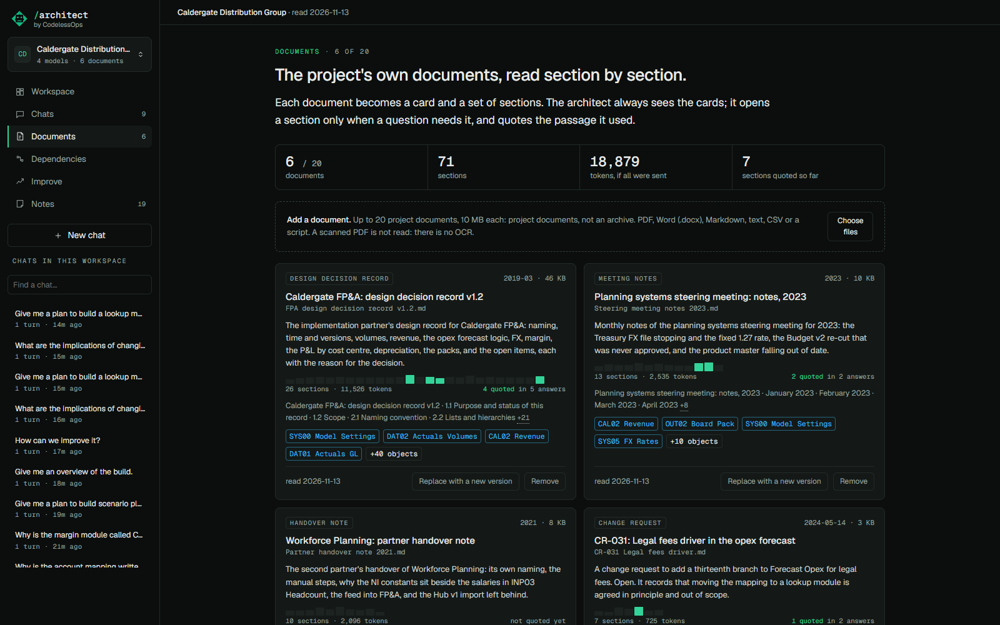

# Documents

## What it does

The exports say what a model is. They do not say why it was built that way. That lives in project documents: a
design decision record, steering notes, a handover note, a change request, a load script. Upload them and a question
that starts with "why" is answered from the passage that records the reason, quoted word for word.

## How to use it

- **Documents** in the nav. *Choose files*: PDF, Word (.docx), Markdown, text, CSV, or a script.
- Each document becomes a **card**: type, date, a two-sentence summary, a strip with one bar per section, its
  headings, and the models, modules and line items it names.
- **Replace with a new version** keeps the card and marks the version. **Remove** takes it away.
- Limits: 20 documents per workspace, 10 MB each. A scanned PDF has no text to read: there is no OCR, and the card
  says so.
- In an answer, a quoted passage shows as a **source card** with the quote marked and the text around it. Click its
  head to open the whole section.

## Documents tied to your modules and line items

When a document is read in, each of its sections is linked to the modules and line items it names. Nothing is
tagged by hand: the names are found in the text against the model's own names. The link is shown both ways.

- **On the object.** Open any module or line item (click its name anywhere). The drawer says *Named in 5 sections
  of 3 documents*; open it for the list, each with the words around the mention, and click one to read the section.
- **On the section.** A section's drawer lists **Objects it names**. On the Documents page, *which sections name
  which objects* opens a card to its sections, each with its object chips.
- **In an answer.** Ask *What do the project documents say about CAL03 Opex?* The architect follows the link first
  (every section that names the object, oldest document first), reads the ones that matter, and only then searches
  by keyword for anything the link missed. The answer draws **Where the documents name it**: the sections grouped by
  document, with the objects each names. The words say what they add up to, and say in one line when two documents
  disagree.

A module is linked through its own name and through any of its line items.

**Quotes keep their names.** A quoted passage that names an object is checked with the name in it. Before, a name
written in backticks inside the quotation marks was blanked out before the passage was looked for, and a true quote
was reported as not found.

## How it is built

- The link: `link_objects` at ingestion, `about` to follow it from the object, the `object_documents` tool, the
  `object_documents` block and `DocLinks` in `web/src/views/Answer.tsx`, `NamedIn` in `web/src/views/Evidence.tsx`.
  Tests: `tests/test_doclinks.py`.

No embeddings and no vector store. Read `src/anaplan_architect/orac/documents.py`.

- **Sections.** A document is split at its headings (Markdown, numbered headings like "4.3 Opex forecast logic",
  Word heading styles, a script's functions). A long section is cut at paragraph ends. YAML front matter is skipped
  and its title used.
- **Cards.** The model sees only the cards: title, type, date, headings, summary, the objects named. A card is not
  evidence. The summary is written once at upload by the model, or taken from the opening sentences when the server
  has no model.
- **Search** is SQLite's own full-text search (FTS5) over the sections, plus a link from each section to the modules
  and line items it names by their exact names. The chat tool `search_documents` returns section hits; `get_section`
  returns one section in full. Only what an answer pulls enters its prompt.
- **Quotes.** Every quoted passage beside a section id is looked for in that section, after folding typography
  (ligatures, soft hyphens, curly quotes). An ellipsis may stand for a short stretch only, with a real phrase on each
  side. Found, it is marked on the source card. Not found, the answer is flagged and the card says so. A word or two
  in quotes that is not in the section is shown as *not checked*: never as verified.
- A document's file is not kept: its text is, by section.
- Tests: `tests/test_documents.py`.
