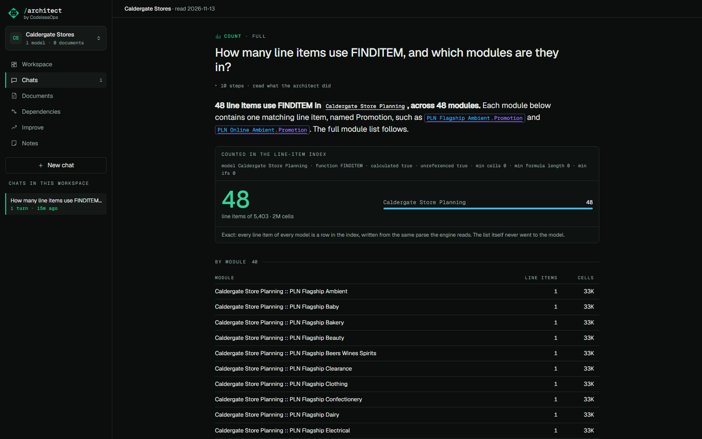

# The line-item index

## What it does

"How many line items use FINDITEM, and which modules are they in?" is a counting question. A model that is shown a
list will count it wrong, or be shown a list that was cut. Here the count comes from an index of every line item of
every model in the workspace, so it is exact however large the model is, and the list never enters the prompt.

## How to use it

Ask. Anything that counts or lists line items goes to the index:

- by a function the formula uses (`FINDITEM`, `IF`, `SUM`, `LOOKUP` ...);
- by what a line item references, or what references it;
- by a dimension it applies to, its format, its summary method, its module;
- calculated or input, referenced or not, above a number of cells, above a formula length, above a number of IFs;
- grouped by model, module, format, function, dimension or summary.

The answer shows the count large, what it is a count of, and the first rows. The demo workspace *Caldergate Stores*
is one model of 5,403 line items for trying this.

## How it is built

Read `src/anaplan_architect/orac/lindex.py`.

- Written from the parse when a snapshot is first read: a row per line item (`li_index`), a row per reference the
  formula grammar found, with every function it sits in (`li_refs`), a row per function a formula uses (`li_funcs`),
  and full-text search over names, formulas and notes.
- The chat tool `query_line_items` returns the exact count, the cells those line items hold, the count by model, an
  optional breakdown, and at most 25 rows.
- The index is checked against the parse on every read and rebuilt when they disagree (a model renamed, a re-parse).
- A `%` or `_` in a name is that character, not a wildcard.
- The same query is at `GET /api/estates/{id}/lineitems`.
- Tests: `tests/test_lindex.py` checks the index against the engine's own figures, line item by line item.
