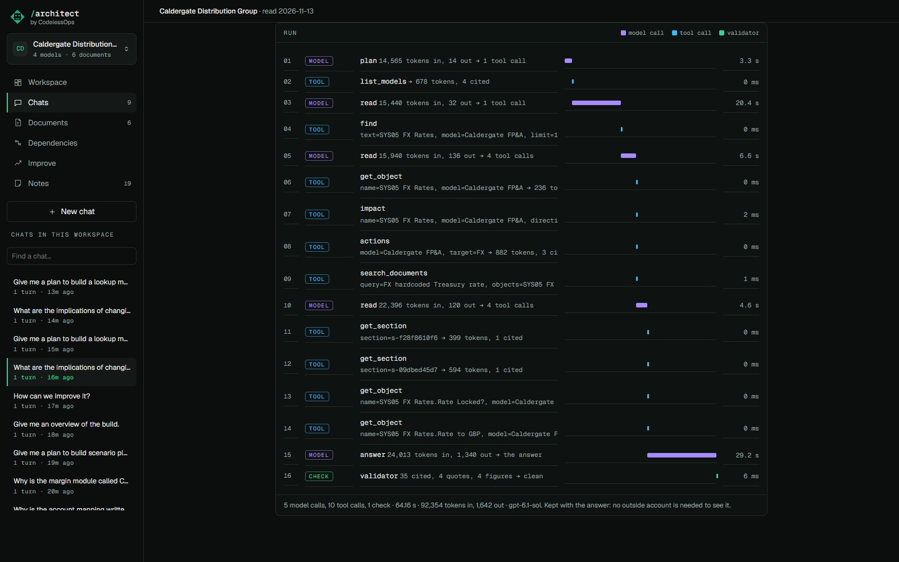

# The run timeline

## What it does

Shows how an answer was reached: each model call and each tool call, in the order they happened, on one time axis,
ending with the validator and its verdict. It needs no outside account and everyone has it.

## How to use it

Click the context chip under an answer; the timeline is below the context list.

A why-answer typically reads: model, `list_models`, model, `search_documents`, model, `get_section`, model (the
answer), then the validator with "clean". Each step shows its arguments, how long it took, and the size of what came
back. A caption gives the number of calls, the seconds and the tokens.

## How it is built

- Built from what the turn stores, not from a tracing service: `run` on the answer, written in
  `Session.ask_stream` in `src/anaplan_architect/chat.py` (`run_json` in the store).
- The panel is drawn with the context view, in `web/src/views/Answer.tsx`.
- Sending the same run to LangSmith is separate and optional: [Tracing](tracing.md).
