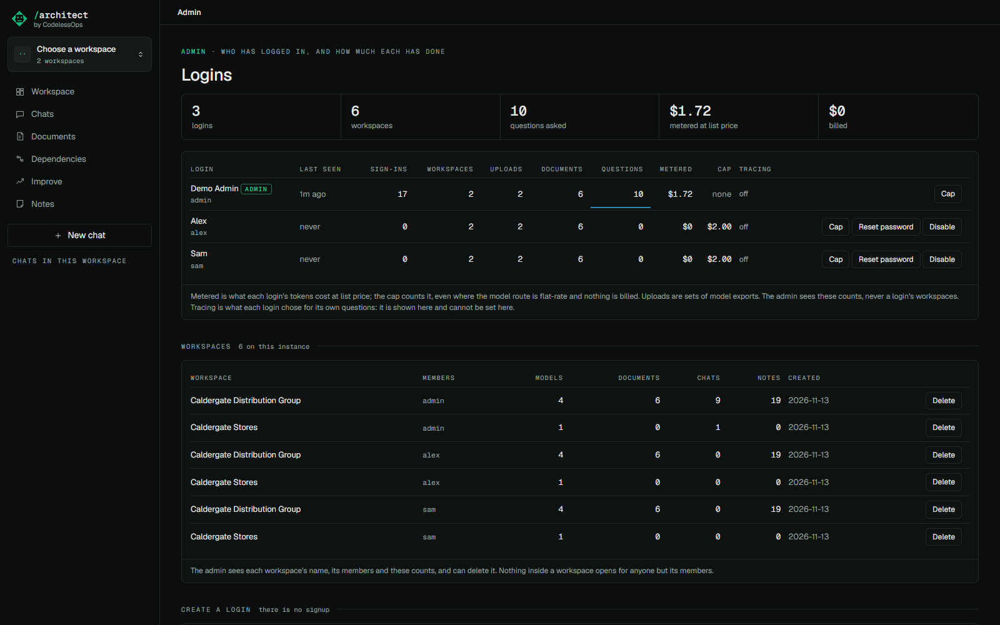

# Spend caps and the admin panel

## What it does

Whoever runs an instance pays for the model. Each login has a spend cap so that one login cannot run up the bill,
and an admin panel shows who has logged in and how much each has done.

## How to use it

**Admin** (bottom left, the admin only):

- **Create a login**: a username and a name. A password is generated and shown once; hand both over. There is no
  signup. Tick *with the demo workspaces* to give the new login its own copy of the demo.
- **Per login**: last seen, sign-ins, workspaces, uploads, documents, questions, metered spend, cap, and what it
  chose for [tracing](tracing.md). **Cap** sets the cap; **Reset password** gives a new one and signs the login out
  everywhere; **Disable** stops it.
- **Workspaces**: every workspace on the instance by name, with its members and counts, and **Delete**. The admin
  cannot open any of them.

A login over its cap is told so, with the amount, instead of an answer. Reading is never capped.

## How the cap counts

- In US dollars at list price, whatever the route bills. On a flat-rate route (a subscription) nothing is billed, so
  tokens are counted at the default model's list price: a cap means the same everywhere.
- The default cap is 2.00 (`ARCHITECT_DEFAULT_CAP_USD`). The admin has none unless one is set.
- Spend is a ledger per login: one row per model call, written when the call returns. Deleting a chat or a
  workspace gives nothing back. A turn that fails or stops part way has still spent what its calls cost.
- The cap is checked before every model call, so a long answer stops when the cap is reached. The summary written
  when a document is uploaded counts too.
- Chats asked at the same moment can overshoot by the calls already in flight. It is a budget guard, not a rate limit.

## How it is built

- The ledger is the `spend` table; `record_spend`, `spent` and `over_cap` in `src/anaplan_architect/orac/auth.py`.
- The gate and the meter are attached to every chat session (`_meter` in `src/anaplan_architect/web.py`) and called
  around each model call (`_one_call` in `src/anaplan_architect/chat.py`).
- The panel is `web/src/views/Admin.tsx` over `GET /api/admin/users` and `GET /api/admin/workspaces`: counts over the
  store, never content.
- Tests: `tests/test_access.py`.
