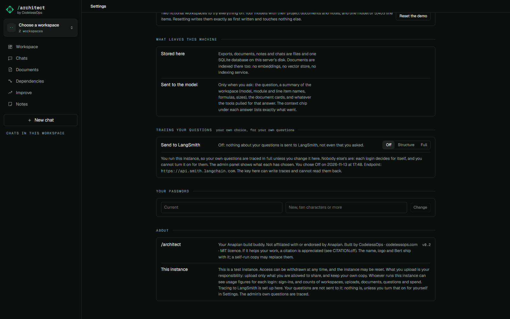

# Tracing

## What it does

The [run timeline](run-timeline.md) under each answer needs no outside account. For someone who runs the app and
wants the full trace in a tracing product, the same run can also be sent to LangSmith.

What is sent is each login's own choice, for that login's own questions. On a shared instance the person running it
does not get to read other people's questions unless they said yes.

| Level | What is sent for a question |
|---|---|
| **Off** | Nothing. Not even that a question was asked. |
| **Structure** | A run tree: the tool names and their order, sizes, tokens, cost, timings, the verdict's counts. Not the question, the answer, tool arguments or results, document text, or any object name. |
| **Full** | The same tree with the content. |

- The admin's own questions: **Full** by default.
- Every other login: **Off** by default.
- With no logins at all (one person, one machine): **Full**, because the person asking is the one who set the key.

## How to use it

- Whoever runs the server sets `LANGSMITH_API_KEY` (and `LANGSMITH_PROJECT`) in `.env`. A tracing-only key is
  enough. `LANGSMITH_ENDPOINT` for the EU region.
- Each login: **Settings**, *Tracing your questions*, Off / Structure / Full. A login that is not the admin's is told,
  before it turns it on, that whoever runs the instance will be able to read what it sends and that it also sits
  with LangSmith. The choice is stored with its time. Turning it off stops anything further; what was already sent
  is not deleted.
- Nobody can set another login's level. The admin panel shows each login's level and cannot change it.
- `LANGSMITH_TRACE_CONTENT=0` is a ceiling for the whole instance: nobody above Structure.
- With no key, the setting says tracing is not set up, and nothing else changes.

## How it is built

- One LangSmith trace per chat: a root run for the chat, a run per question under it, and under each question its
  model calls, tool calls and the validator, written with explicit parents so the hierarchy holds while the answer
  streams. Read `src/anaplan_architect/orac/telemetry.py`.
- The level is read for every question from whoever asked it (`_trace` in `src/anaplan_architect/web.py`) and passed
  to the tracer for that turn; a change applies from the next question. The summary written when a document is
  uploaded follows the uploader's level.
- With content off, every string is replaced by its size before the client is handed anything (`shape`). A dict key
  is kept only when it is a field name the code knows; any other key is numbered.
- With content on, strings shaped like API keys and email addresses are replaced first (`mask`).
- A tracing failure never fails an answer: it is kept and shown in Settings.
- Tests: `tests/test_trace.py`, `tests/test_trace_levels.py`.
