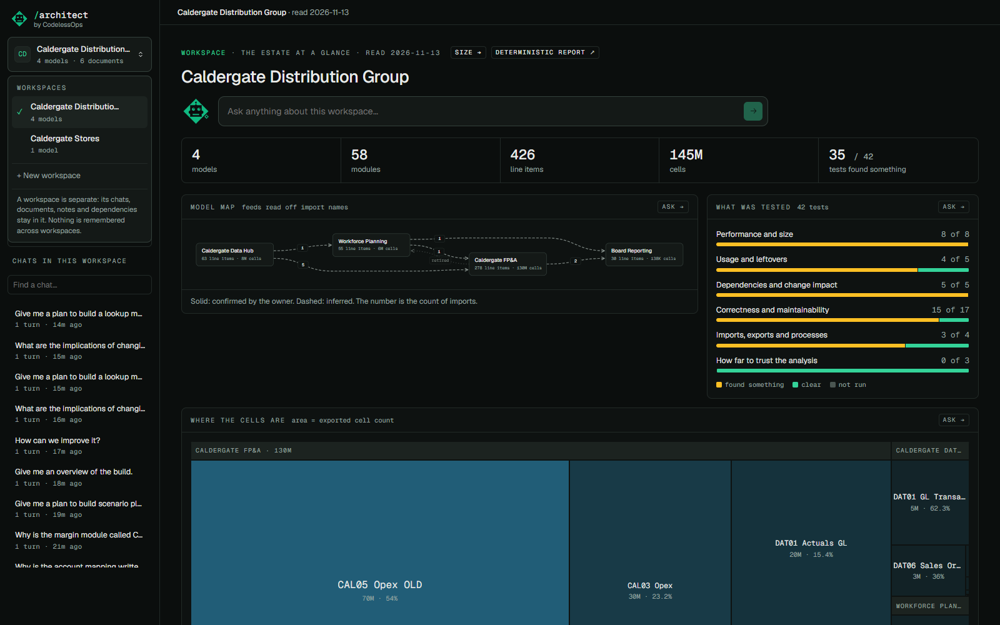

# Workspaces and logins

## What it does

A workspace is one estate: one or more Anaplan models, known from their exports, with its own documents, notes,
chats and decisions. It is an isolated unit. A chat belongs to one workspace and remembers nothing of another.

A login can have many workspaces. Only its members can see a workspace; to anyone else it does not exist.

## How to use it

- **Switch**: the dropdown at the top of the sidebar lists your workspaces. Everything on the page follows it.
- **Create**: `+ New workspace`. One row per model: its Line Items export, and optionally its Actions and Modules
  exports. The model's name is taken from the file when the file carries one ("FP&A - Line Items.csv"); a file called
  just "Line Items.csv" has to be named by hand.
- **Upload a newer set**: Workspace page, *Models and their exports*. It is parsed, then activated. Chats held on the
  earlier upload say so and offer to re-ask on the new one.
- **Delete**: the bin on a row of the dropdown, or *Workspace settings*. The dialog says what goes with it (models,
  documents, chats, notes) and asks for the name typed back. There is no undo; download a backup first.
- **The demo**: Settings, *Reset the demo*, writes two fictional workspaces (Caldergate). Each login gets its own copy.
- **Sign in**: a username and a password. There is no signup: the admin creates each login and hands it over.
  With no logins at all and the server bound to localhost, the app is open to the one person at the machine.

## Private and Shared

A workspace is one of two things.

- **Private.** Only the login that made it can open it. This is the default, and it is what every workspace was
  before sharing existed.
- **Shared with your team.** Everyone in your team can open it, ask in it and add to it. Nobody outside the team can.

A **team** is a company. The admin makes a team once, by name (*Teams*, *New team*, in the admin panel), and then
picks it from a list for each login, when creating the login or later. Typing a name on a login never makes a team, so
a typo cannot become a second company. A new team whose name reads like one already there ("Acrne" beside "Acme", the
same word in another alphabet, a trailing full stop) is not made until the admin confirms it is a different company. A login is in at most one team. An admin is in none. Shared never means everyone on the instance: an instance can hold several companies, and one company's
models are not made visible to another's by a setting. A login with no team is on its own and has no Shared option.

**Choosing.** On the new-workspace page, *Who can see it*: Private or Shared with your team, with a line under each.
The workspace switcher shows which of your workspaces are private and which are shared, with which team and by whom.

**Changing it later.** On the workspace's page, the line under its name says who can open it. The login that made it
has *Share with <team>* or *Make private* there. The dialog says who gains or loses access before anything happens.
The admin can make a workspace private from the admin panel, without opening it. The admin cannot share one: only
its maker does.

**A shared workspace belongs to the team it is shared with.** Its maker is a member like the others: through the
team. When the maker is moved out of that team, the workspace stays with the team and the maker loses it. It then has
no maker until the admin names a team-mate as its maker, in the admin panel, still without opening it; until then the
admin can delete it. A workspace goes back only to the team it was last shared with, or to a team that every one of
its authors is in now: what a team-mate added never follows the maker to another company.

**Inside a shared workspace.**

- Every member sees its models, documents, notes and **all of its chats**, including chats others started. The line
  above the chat box says so before you type: *Everyone in <team> can read and add to the chats, documents and notes
  of this workspace.*
- Each answer shows who asked. Each note and document shows who added it.
- Any member can ask (in anyone's chat), start a chat, upload documents, add notes and upload a new set of exports.
- A member changes or removes only what they added: their own chats, notes, documents and uploads. The maker can
  change or remove any of it.
- That covers the less obvious ones too: withdrawing a proposal, having a draft upload read, clearing a note's review
  flag.
- Renaming or archiving the workspace, renaming or retiring its models, and taking a backup are the maker's.
- Only the maker, or the admin, can make it private again or delete it. The delete dialog names who else loses it.
- An answer being written stops if its asker loses the workspace meanwhile (moved out of the team, disabled, or the
  workspace made private): nothing more is read for them, and nothing is shown or kept.

**Leaving.** A login moved out of a team, or disabled, loses that team's shared workspaces at once. What they asked
and added stays in the workspace. Access through a team is worked out each time, from the team the login is in at
that moment. It is not copied anywhere that could go stale.

**What stays each login's own.**

- **Spend.** A question counts against the cap of the login that asked it, in a shared workspace too.
- **Tracing.** One member turning tracing on does not send another member's questions anywhere, even in the same chat.
- **The demo workspaces.** Each login has its own copy; they are private.

**Backups.** The maker takes the backup of a shared workspace. A backup carries no team. Restored, it comes back as
a new workspace, Private to whoever restored it, with everything in it under their name; who the backup says wrote
each chat, note and document is kept beside it as text.

**What the admin sees.** For each workspace: its name, whether it is private or shared and with which team, its
members and counts. Never its content: an admin is in no team, so no shared workspace opens for one.

## How it is built

- Sharing: tables `teams`, `users.team_id`, `estates.visibility` and `estates.team_id` (migrations 014 and 015).
  Membership is still the one check, `is_member` in `src/anaplan_architect/orac/access.py`: a private workspace's
  member row, or a shared workspace whose team is the login's team now (and never an admin). `set_team`,
  `set_visibility` and `set_maker` there hold the rules above; `_maker_only` and `_theirs` in `web.py` hold who may
  change what. `tests/test_review_sharing.py` has one test per finding of the 2026-11-24 review. `describe` there writes the sentences the pages show. The screens are in
  `web/src/views/Access.tsx`. Tests: `tests/test_access.py` walks every route as a team-mate, a login in another team,
  a login with no team, an ex-team-mate and the admin; `tools/sharing_check.py` does the same in a real browser.

- **Membership** is a row per workspace and login (`estate_members`). One middleware checks it before any handler
  runs: a request that names a workspace, or anything that lives in one, is answered only to a member, and with 404
  to anyone else. Read `src/anaplan_architect/orac/access.py` and the `guard` middleware in
  `src/anaplan_architect/web.py`.
- **Asking whether a login is a member never writes.** Memberships are written when a workspace is created or
  restored, and when the first admin is created on a store that ran with no logins.
- **Sign-in** (`orac/auth.py`): scrypt password hashes, a session token stored as its hash, a second cookie that every
  changing request must echo in a header. Five failures for a name or twenty from an address in fifteen minutes and
  sign-in is refused without looking at the password.
- **The demo** is written from the files under `examples/caldergate/` by `orac/demo.py`.
- Tests: `tests/test_access.py` walks every route as a non-member.

Isolation is in name only: one SQLite file, one process. [What that means](../SECURITY.md).
