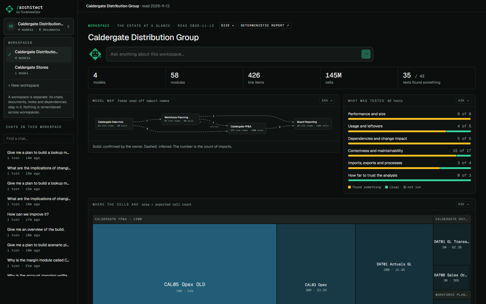

# Workspaces and logins

## What it does

A workspace is one estate: one or more Anaplan models, known from their exports, with its own documents, notes,
chats and decisions. It is an isolated unit. A chat belongs to one workspace and remembers nothing of another.

A login can have many workspaces. Only its members can see a workspace; to anyone else it does not exist.

## How to use it

- **Switch**: the dropdown at the top of the sidebar lists your workspaces. Everything on the page follows it.
- **Create**: `+ New workspace`. One row per model: its Line Items export, and optionally its Actions and Modules
  exports. The model's name is taken from the file when the file carries one ("FP&A - Line Items.csv"); a file called
  just "Line Items.csv" has to be named by hand.
- **Upload a newer set**: Workspace page, *Models and their exports*. It is parsed, then activated. Chats held on the
  earlier upload say so and offer to re-ask on the new one.
- **Delete**: the bin on a row of the dropdown, or *Workspace settings*. The dialog says what goes with it (models,
  documents, chats, notes) and asks for the name typed back. There is no undo; download a backup first.
- **The demo**: Settings, *Reset the demo*, writes two fictional workspaces (Caldergate). Each login gets its own copy.
- **Sign in**: a username and a password. There is no signup: the admin creates each login and hands it over.
  With no logins at all and the server bound to localhost, the app is open to the one person at the machine.

## How it is built

- **Membership** is a row per workspace and login (`estate_members`). One middleware checks it before any handler
  runs: a request that names a workspace, or anything that lives in one, is answered only to a member, and with 404
  to anyone else. Read `src/anaplan_architect/orac/access.py` and the `guard` middleware in
  `src/anaplan_architect/web.py`.
- **Asking whether a login is a member never writes.** Memberships are written when a workspace is created or
  restored, and when the first admin is created on a store that ran with no logins.
- **Sign-in** (`orac/auth.py`): scrypt password hashes, a session token stored as its hash, a second cookie that every
  changing request must echo in a header. Five failures for a name or twenty from an address in fifteen minutes and
  sign-in is refused without looking at the password.
- **The demo** is written from the files under `examples/caldergate/` by `orac/demo.py`.
- Tests: `tests/test_access.py` walks every route as a non-member.

Isolation is in name only: one SQLite file, one process. [What that means](../SECURITY.md).
